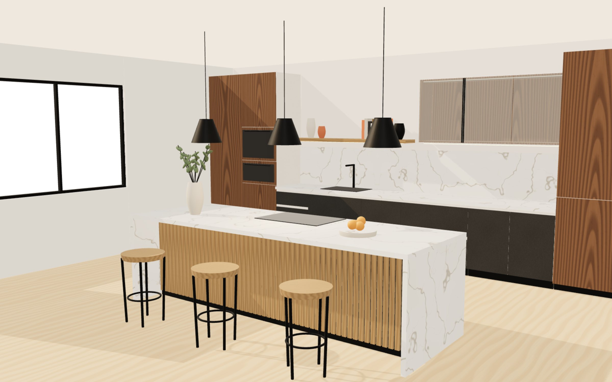

# Oliver Plan · site de móveis planejados premium

Site completo de uma marcenaria de alto padrão: hero 3D cinematográfico, tour 360° navegável, visualizador de materiais, antes e depois interativo, catálogo filtrável e um orçamento inteligente em etapas que envia o pedido pelo WhatsApp ou por e-mail.

A marca padrão é **Oliver Plan** ([@oliverplanoficial](https://www.instagram.com/oliverplanoficial/)). Existe um segundo preset pronto, **Ateliê Forma**: basta trocar uma variável de ambiente (veja [Marca](#marca-e-dados-de-contato)).



## Como rodar

Requisitos: **Node.js 20.9 ou mais novo** e npm.

```bash
cd oliver-plan-site
npm install
cp .env.example .env.local   # opcional: marca, URL do site e webhooks
npm run dev                  # http://localhost:3000
```

Produção:

```bash
npm run build
npm start
```

O deploy mais simples é na Vercel: importe o repositório, defina a pasta raiz como `oliver-plan-site` e configure as variáveis do `.env.example`.

## Stack

- **Next.js 16** (App Router, Turbopack) + **React 19** + **TypeScript**
- **Tailwind CSS 4** (tokens de design em `src/app/globals.css`)
- **Three.js + React Three Fiber + Drei**: cenas 3D 100% procedurais (sem modelos para baixar)
- **GSAP + ScrollTrigger**: seção com pin e scroll horizontal
- **Motion** (o antigo Framer Motion): revelações, transições, microinterações
- **Lenis**: rolagem suave sincronizada com o ScrollTrigger
- **Lucide React**: ícones
- Fotos do **Unsplash** servidas pela CDN deles (redimensionamento e AVIF/WebP automáticos)

## O que tem no site

### Efeitos 3D e motion

| Recurso | Onde | Arquivo principal |
|---|---|---|
| Hero 3D: cozinha em "maquete" que se monta peça por peça, câmera em travelling com o scroll e parallax com o mouse, cotas técnicas surgindo | Home | `src/components/three/HeroCanvas.tsx`, `src/sections/home/Hero.tsx` |
| Tour 3D navegável "de dentro" (arrastar, setas do teclado, pontos de vista, hotspots, troca de acabamento em tempo real, tela cheia) | Home, projetos, showroom | `src/components/features/Tour3D.tsx`, `src/components/three/TourCanvas.tsx` |
| Antes e depois em 3D: o mesmo quadro renderizado duas vezes com scissor (cômodo vazio com marcações de obra × cozinha pronta) | Home, processo | `src/components/three/BeforeAfterCanvas.tsx` |
| Antes e depois com fotos | Portfólio, projetos | `src/components/features/BeforeAfterSlider.tsx` |
| Visualizador de materiais: elevação técnica 4.200 × 2.700 mm que recebe a textura ao passar o mouse | Home | `src/components/features/MaterialVisualizer.tsx` |
| Texturas procedurais (madeira, pedra, laca, vidro canelado, linho) usadas igualmente no CSS e no 3D | todo o site | `src/lib/textures.ts` |
| Cards com inclinação 3D, brilho e zoom | todo o site | `src/components/ui/TiltCard.tsx` |
| Cursor customizado com efeito magnético e rótulos ("Ver projeto", "Arraste") | desktop | `src/components/motion/Cursor.tsx`, `src/components/ui/Magnetic.tsx` |
| Títulos revelados palavra a palavra (ou letra a letra) por máscara | todo o site | `src/components/ui/RevealText.tsx` |
| Rolagem suave (Lenis) + ScrollTrigger | todo o site | `src/components/motion/SmoothScroll.tsx` |
| Transição entre páginas com cortina | todo o site | `src/components/motion/PageTransition.tsx` |
| Marquee infinito que acelera e inverte com o scroll | Home | `src/components/ui/Marquee.tsx` |
| Abertura com o logotipo se formando e contador 000→100 (só na primeira visita da sessão) | todo o site | `src/components/motion/Loader.tsx` |
| Ambientes em scroll horizontal com pin (GSAP) | Home | `src/sections/home/FeaturedRooms.tsx` |

### Páginas

- **Home** (`/`): hero 3D, marquee de tipologias, manifesto com números, ambientes em destaque, "Por que Oliver Plan?", antes e depois, visualizador de materiais, processo em 4 etapas, galeria de projetos, tour 3D, depoimentos, CTA de orçamento, newsletter e rodapé.
- **Ambientes** (`/ambientes`): grade das 7 categorias e catálogo com filtros por ambiente, estilo, material e cor, mais busca livre. Os filtros ficam na URL (`/ambientes?categoria=cozinha&estilo=moderno`), então dá para compartilhar.
- **Projeto** (`/projetos/[slug]`): abertura com parallax, ficha técnica, galeria editorial com lightbox, tour 3D, materiais, ferragens, acabamentos, elevação técnica em SVG gerada a partir das medidas, antes e depois, relacionados e CTA (com barra fixa no celular).
- **Portfólio** (`/portfolio`): galeria em colunas com filtros por ambiente e estilo, busca e uma seção de antes e depois.
- **Sobre** (`/sobre`): história, linha do tempo, valores, processo de fabricação com imagem fixa e o time.
- **Processo** (`/processo`): as 6 etapas (briefing, visita técnica, projeto 3D, aprovação, produção, montagem) com entregáveis, comparador 3D e perguntas frequentes.
- **Contato** (`/contato`): orçamento em 5 etapas, WhatsApp, endereço, horários, redes e mapa.
- **Showroom** (`/showroom`): tour 3D do showroom (vinhetas de cozinha, closet, living e parede de amostras) e agendamento de visita.

### Orçamento inteligente

`src/components/features/QuoteWizard.tsx`

1. **Ambiente** (múltipla escolha) → 2. **Estilo** → 3. **Projeto** (metragem, investimento, prazo, fase da obra, se tem arquiteto) → 4. **Contato** (com máscara de telefone e consentimento LGPD) → 5. **Revisão**.

- Envio pelo **WhatsApp** (mensagem pronta e organizada) ou por **e-mail**.
- O lead também é registrado em `POST /api/orcamento`. Com `LEADS_WEBHOOK_URL` configurada (Zapier, Make, n8n, planilha, CRM), ele é repassado para lá; sem ela, aparece no log do servidor.
- Vindo da página de um projeto, o formulário já chega preenchido (`/contato?ambiente=cozinha&estilo=moderno&projeto=cozinha-jacaranda`).
- O rascunho fica salvo no navegador. Há um campo armadilha contra robôs.

### SEO, performance e acessibilidade

- Metadados por página, Open Graph e Twitter, imagem OG gerada (`src/app/opengraph-image.tsx`), `sitemap.xml`, `robots.txt`, manifest e JSON-LD (`FurnitureStore`, `CreativeWork` em cada projeto e `FAQPage`).
- Todas as páginas são pré-renderizadas (estáticas). O Three.js só é baixado quando a cena entra na tela (`next/dynamic` + `IntersectionObserver`), e cada cena para de renderizar quando sai da tela.
- Imagens responsivas com lazy loading. Se uma foto falhar, entra o render 3D local da mesma categoria e, por último, uma prancha de material (nunca um ícone de imagem quebrada).
- Link "Pular para o conteúdo", foco visível, navegação por teclado no tour (setas, + e −), no comparador (setas, Home, End), na galeria (← → Esc) e no menu (Esc).
- `prefers-reduced-motion` desliga a abertura, a rolagem suave, o cursor customizado, os tilts, a montagem animada da cena e o parallax de câmera.
- No celular, o tour 3D só captura o toque depois de "Toque para explorar", para não travar a rolagem.

## Estrutura de pastas

```
oliver-plan-site/
├── public/renders/          renders estáticos gerados das cenas 3D
├── scripts/render-stills.mjs  regera os renders (veja abaixo)
└── src/
    ├── app/                 rotas (App Router), API, SEO
    ├── components/
    │   ├── features/        orçamento, tour, comparadores, visualizador, catálogo, galeria…
    │   ├── layout/          cabeçalho, rodapé, logotipo, cabeçalho de página
    │   ├── motion/          Lenis, cursor, loader, transição de páginas
    │   ├── three/           kit de marcenaria procedural, cenas, luzes, canvases
    │   └── ui/              botões, textos revelados, cards com tilt, marquee, imagens…
    ├── data/                marca, projetos, categorias, acabamentos, textos, imagens
    ├── hooks/               media queries, visibilidade, WebGL, fim da abertura
    ├── lib/                 texturas procedurais, loader de imagens, WhatsApp, GSAP
    └── sections/            seções da home, do sobre e do processo
```

## Marca e dados de contato

Tudo fica em `src/data/brand.ts`. Para trocar de marca:

```bash
NEXT_PUBLIC_BRAND=atelie   # Ateliê Forma
NEXT_PUBLIC_BRAND=oliver   # Oliver Plan (padrão)
```

## Conteúdo

- **Projetos**: `src/data/projects.ts` (18 projetos com categoria, estilo, material, cor, medidas, acabamentos, ferragens, galeria e antes/depois). Para criar um novo, copie um item e troque o `slug`; a página, o sitemap e os filtros se atualizam sozinhos.
- **Acabamentos**: `src/data/finishes.ts`. Cada acabamento define a textura procedural e o material 3D; ele aparece no visualizador, no tour e nas fichas dos projetos.
- **Textos institucionais, depoimentos, time, processo e perguntas frequentes**: `src/data/content.ts`.
- **Fotos**: `src/data/images.ts` (IDs do Unsplash e renders locais).

### Regerar os renders 3D

As imagens de `public/renders` são capturas das próprias cenas procedurais (`/render-3d?id=…`, rota que só existe em desenvolvimento). Depois de mudar uma cena ou um acabamento:

```bash
npm i -D playwright && npx playwright install chromium
npm run dev
node scripts/render-stills.mjs http://localhost:3000
```

## Antes de publicar

O Instagram da Oliver Plan não pôde ser acessado durante a criação, então alguns dados são provisórios e estão marcados com `CONFIRMAR` no código:

- [ ] **WhatsApp e telefone**: hoje `(11) 90000-0000`, um número provisório (`src/data/brand.ts`). Até ser trocado, os botões de WhatsApp não chegam à empresa.
- [ ] **E-mail** `contato@oliverplan.com.br`.
- [ ] **Endereço do showroom e ano de fundação**: vieram de um cadastro público de "Oliver Planejados" em Barueri - SP (Solutudo). Confirme se é a mesma empresa do @oliverplanoficial.
- [ ] **Horários do showroom**.
- [ ] **Projetos, depoimentos, time e números** (1.200+ ambientes, 98% etc.) são **ilustrativos**. Troque pelos reais, com fotos autorizadas pelos clientes.
- [ ] **Fotos**: as do Unsplash são de uso livre, mas não são da empresa. Substitua pelas fotos dos projetos reais.
- [ ] Configure `NEXT_PUBLIC_SITE_URL` e, se quiser receber os leads num CRM, `LEADS_WEBHOOK_URL` e `NEWSLETTER_WEBHOOK_URL`.
